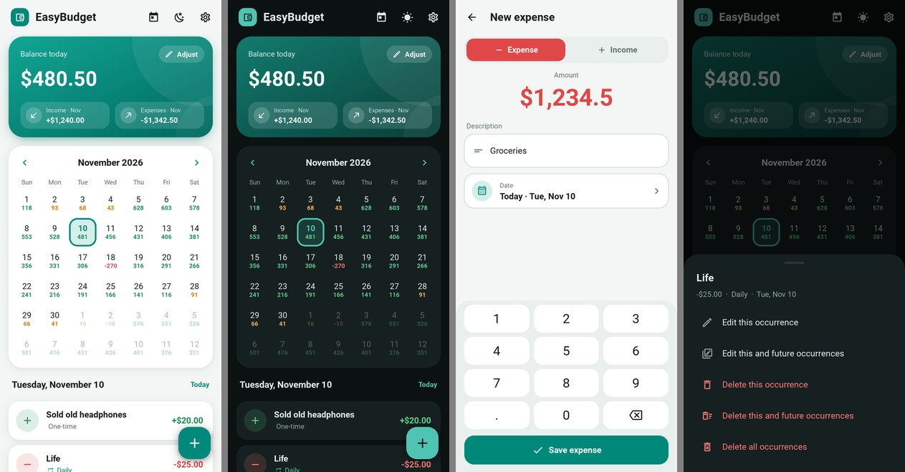

# EasyBudget

A simple, **offline**, **ad-free** personal budget tracker. See your balance
for every day on a calendar, and plan ahead with recurring income and expenses.

This repository contains two separate apps:

| Folder | App | Built with |
| --- | --- | --- |
| [`android/`](android) | **Android phone app** – redesigned UI with light & dark mode | Python · Kivy · KivyMD · Buildozer |
| [`windows/`](windows) | **Windows desktop app** – the original version | Python · Kivy · KivyMD |

## Quick start

- **Android:** download the APK from the latest *Android APK* run in the
  repository's **Actions** tab, or build it yourself – see
  [android/README.md](android/README.md).
- **Windows:** double-click `windows/run.bat` – see
  [windows/README.md](windows/README.md).

Both apps store everything locally in SQLite. Nothing is sent anywhere.
