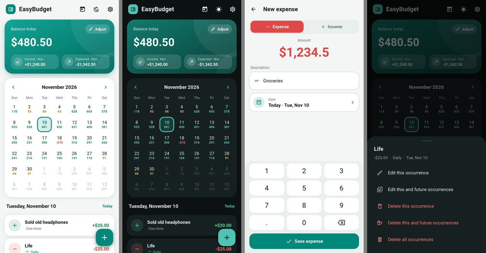

# EasyBudget for Android

A clean, **ad-free**, fully **offline** budget tracker for your phone, with a
**light and dark theme**. Built with Python, [Kivy](https://kivy.org) and
[KivyMD](https://github.com/kivymd/KivyMD), packaged with
[Buildozer](https://github.com/kivy/buildozer).



## Features

- **Balance card** – the balance of the selected day, plus this month's income
  and expenses, with a warning when you dip below your threshold or below zero.
- **Profiles** – keep separate budgets (e.g. Personal, Work, Savings), each
  with its own transactions and balance. Tap the profile name in the top bar
  to switch, add, rename or delete profiles.
- **Calendar** – every day shows its ending balance, colored
  green / orange (below your warning) / red (negative).
  Swipe left/right or use the arrows to change month; tap the month name to
  jump back to today.
- **Expenses & income** – one-off or recurring: every day, week, 2/3/4 weeks,
  month, 2/3/6 months or year.
- **Edit or delete** a single occurrence, *this and all future* occurrences,
  or a whole series.
- **Adjust current balance** to match your real bank account.
- **Settings** – theme (follow phone / light / dark), currency, low balance
  warning, first day of the week.
- **Backup** – Settings → Export data saves everything (all profiles,
  transactions, recurring entries and settings) to a file wherever you choose
  (Downloads, Google Drive...). Import data restores such a file. No storage
  permission is needed: Android's own file picker is used.
- **Private** – no ads, no tracking, no account, no internet permission.
  Data stays in the app's private storage on your phone.

The quick theme button (moon/sun) in the top bar flips between light and dark;
Settings → Theme → *System* makes the app follow your phone's dark mode.

## Get the APK

### Option 1 – let GitHub build it (no setup needed)

Every push that changes `android/` runs the **Android APK** workflow
(`.github/workflows/android-apk.yml`). You can also start it by hand from the
repository's **Actions** tab → *Android APK* → *Run workflow*.

1. Open the finished run and download the **EasyBudget-apk** artifact (a zip).
2. Unzip it and copy the `.apk` to your phone.
3. Open it on the phone and allow "Install unknown apps" for your file manager
   or browser when Android asks.

The first build takes roughly 20–40 minutes (it downloads the Android SDK/NDK);
later builds reuse a cache.

#### Updating without losing data

Always take the APK from the newest run on the **main** branch and install it
over the app you have - your data stays. Every build is signed with the same
key (its fingerprint is shown in each run's summary), which is what lets
Android update the app in place.

If Android ever says the app "conflicts with an existing package", the new APK
has a different key. Then: **Settings → Export data**, uninstall, install the
new APK, and **Settings → Import data**.

#### How the signing key is kept

The first build on `main` creates the key and stores it in the repository's
Actions cache; all later builds (on any branch) reuse it, and a small weekly
job keeps the cache from expiring. GitHub can still drop it if the repository
sits completely unused for a couple of months, so for a key that can never
change, store your own as a repository secret:

```bash
keytool -genkeypair -v -keystore easybudget.keystore -storepass android \
  -alias androiddebugkey -keypass android -keyalg RSA -keysize 2048 \
  -validity 10000 -dname "CN=EasyBudget,O=EasyBudget,C=US"
base64 -w0 easybudget.keystore     # macOS: base64 -i easybudget.keystore
```

Then on GitHub: **Settings → Secrets and variables → Actions → New repository
secret**, name it `DEBUG_KEYSTORE_BASE64` and paste the base64 text. Keep
`easybudget.keystore` somewhere safe (not in the repo). Switching to it changes
the key once, so export your data before installing that build.

### Option 2 – build on your own computer

Buildozer needs Linux or macOS (on Windows, use WSL2 with Ubuntu):

```bash
sudo apt install -y git zip unzip openjdk-17-jdk python3-pip autoconf automake \
  libtool libltdl-dev pkg-config zlib1g-dev libncurses-dev cmake libffi-dev libssl-dev
pip install --user --upgrade buildozer

cd android
buildozer android debug            # APK ends up in android/bin/
buildozer android debug deploy run # or: install straight onto a USB-connected phone
# (CI builds use `buildozer android release` with a fixed signing key instead,
#  see .github/workflows/android-apk.yml)
```

## Try it on your computer first

The same code runs in a phone-sized window on Windows, macOS or Linux:

```bash
cd android
python -m venv .venv
.venv/bin/pip install -r requirements-desktop.txt    # Windows: .venv\Scripts\pip ...
.venv/bin/python main.py
```

Esc acts as the phone's Back button.

## Tests

```bash
cd android
python -m unittest discover -s tests -v
```

## Project layout

```
android/
├── main.py                 # entry point Buildozer runs
├── buildozer.spec          # Android packaging settings (name, icon, API level...)
├── requirements-desktop.txt
├── assets/                 # launcher icon + splash screen
├── easybudget/
│   ├── app.py              # app state, navigation, theme switching, dialogs
│   ├── screens.py/.kv      # Home, Add/Edit and Settings screens
│   ├── widgets.py/.kv      # calendar, keypad, cards, bottom sheets, ...
│   ├── dialogs.py          # date picker, choice/confirm/amount sheets
│   ├── theme.py            # light & dark color palettes
│   ├── database.py         # SQLite storage + recurring transactions
│   ├── formatting.py       # money formatting / parsing, repeat intervals
│   └── android_utils.py    # status bar color, system dark mode (no-ops on desktop)
└── tests/                  # unit tests for the data layer
```

## Notes

- The APK is built for 64-bit ARM phones (`arm64-v8a`), which covers
  practically every phone from the last several years.
- `buildozer.spec` targets Android API 34. That's right for installing the APK
  yourself; publishing on Google Play would need a newer target API (and an app
  name other than "EasyBudget", which is already taken there).
- The database uses the same tables as the Windows version (plus a few
  additions), so the two stay easy to keep in sync.
